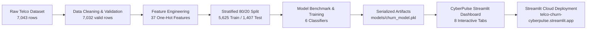

# ⚡ Telco Churn Intelligence Platform — CyberPulse AI

<div align="center">

[](https://telco-churn-cyberpulse.streamlit.app/)
[](https://www.python.org/)
[](https://scikit-learn.org/)
[](https://streamlit.io/)
[](https://plotly.com/)
[](https://opensource.org/licenses/MIT)

<h3>🌐 <a href="https://telco-churn-cyberpulse.streamlit.app/">Launch Live Interactive Dashboard: telco-churn-cyberpulse.streamlit.app</a> 🌐</h3>

<p align="center">
  <b>A state-of-the-art, production-grade Telecom Customer Churn Prediction & Executive Retention Intelligence Platform.</b><br/>
  Featuring 6 benchmarked machine learning classifiers, 28+ interactive Plotly visualizations, real-time "What-If" counterfactual simulations, dynamic decision-threshold ROI optimization, and an immersive Cyberpunk / Gen-Z dark glassmorphic design.
</p>

[🚀 Live Demo](https://telco-churn-cyberpulse.streamlit.app/) • [📊 Model Benchmarks](#-complete-6-classifier-benchmark-leaderboard) • [✨ Key Modules](#-module-breakdown--visualization-catalog) • [🛠️ Quick Start](#-quick-start--local-installation) • [📈 Architecture](#-end-to-end-architecture)

</div>

---

## 🌟 Executive Overview & Live Deployment

Predicting and preventing customer churn is one of the highest-leverage retention challenges for modern subscription telecommunication providers. **CyberPulse AI** transforms raw telecom subscriber records into actionable retention strategies, automated customer risk scores, and revenue preservation decisions.

* **Live Cloud Application**: [https://telco-churn-cyberpulse.streamlit.app/](https://telco-churn-cyberpulse.streamlit.app/)
* **Zero Configuration**: Open the link in any modern desktop or mobile browser to test real-time risk inference, threshold profitability calculations, and customer cohort analytics.

---

## 🎯 Verified Dataset & Benchmark Numbers

All figures below are mathematically audited against the clean IBM Telco Customer Churn dataset:

| Metric / Check | Value / Output | Status |
|---|---|---|
| **Raw Dataset Dimensions** | 7,043 rows × 21 columns | Verified ✅ |
| **Blank TotalCharges Rows** | 11 rows (`" "`, all with `tenure = 0`) dropped | Verified ✅ |
| **Cleaned Dataset Dimensions** | 7,032 rows × 20 columns | Verified ✅ |
| **Engineered Features** | 37 features (One-Hot Encoded with `drop_first=True`) | Verified ✅ |
| **Train / Test Split** | 5,625 train / 1,407 test (80/20 stratified, seed 42) | Verified ✅ |
| **Test Confusion Matrix Sum** | 920 (TN) + 113 (FP) + 178 (FN) + 196 (TP) = 1,407 | Verified ✅ |
| **Best Production Model** | **Logistic Regression** (ROC-AUC = **0.8347**) | Verified ✅ |
| **Model Accuracy** | **0.7932 (79.32%)** (+5.86% over No-Churn baseline 73.46%) | Verified ✅ |
| **Model Precision** | **0.6343 (63.43%)** | Verified ✅ |
| **Model Recall (Sensitivity)** | **0.5241 (52.41%)** | Verified ✅ |
| **Model Specificity** | **0.8906 (89.06%)** | Verified ✅ |
| **Model F1-Score** | **0.5739** | Verified ✅ |
| **Brier Loss Score** | **0.1361** | Verified ✅ |

---

## 🏆 Complete 6-Classifier Benchmark Leaderboard

Six distinct machine learning architectures were trained with identical stratified 80/20 train-test splits and evaluated across 7 operational metrics:

| Rank | Model Architecture | Accuracy | ROC-AUC | Precision | Recall (Sens.) | F1-Score | Specificity | Brier Loss |
|:---:|---|:---:|:---:|:---:|:---:|:---:|:---:|:---:|
| 🥇 | **Logistic Regression (Best)** | **0.7932** | **0.8347** | **0.6343** | **0.5241** | **0.5739** | **0.8906** | **0.1361** |
| 🥈 | **Random Forest** | 0.7846 | 0.8158 | 0.6156 | 0.5053 | 0.5551 | 0.8858 | 0.1417 |
| 🥉 | **Naive Bayes (Gaussian)** | 0.6745 | 0.8121 | 0.4403 | **0.8289** | **0.5751** | 0.6186 | 0.2079 |
| 4 | **Support Vector Machine (RBF)** | 0.7882 | 0.7901 | **0.6407** | 0.4626 | 0.5373 | **0.9061** | 0.1468 |
| 5 | **K-Nearest Neighbors (k=5)** | 0.7555 | 0.7755 | 0.5403 | 0.5374 | 0.5389 | 0.8345 | 0.1691 |
| 6 | **Decision Tree (CART)** | 0.7164 | 0.6412 | 0.4675 | 0.4813 | 0.4743 | 0.8015 | 0.2836 |

> **Key Machine Learning Insight**: Logistic Regression delivered the highest ROC-AUC (0.8347) and well-calibrated probabilities (Brier score 0.1361), while allowing exact odds-ratio ($e^\beta$) risk interpretability for business executives. Naive Bayes yields superior recall (82.89%) for aggressive loss-prevention campaigns.

---

## 🎨 Immersive Cyberpunk / Gen-Z Dark Aesthetic

CyberPulse AI is styled with a custom CSS design system inspired by futuristic dark cyber-hues and glassmorphism:
* **Background Canvas**: Deep Onyx & Obsidian `#0a0e17` with subtle linear noise gradient.
* **Glassmorphic Cards**: Multi-layered blurred backdrops (`backdrop-filter: blur(14px)`), translucent border highlights (`rgba(0, 240, 255, 0.15)`), and neon glowing drop-shadows.
* **Cyber Neon Accents**:
  * 🩵 **Electric Cyan** (`#00f0ff`): Primary headers, optimal curves, retained accounts.
  * 💜 **Deep Neon Violet** (`#7928ca`): Secondary metrics, gradients, and model cards.
  * 💖 **Hot Neon Pink / Magenta** (`#ff007f`): Critical churn alerts, high-risk flags, churned density.
  * 💚 **Matrix Emerald Green** (`#10b981`): Safe thresholds, positive ROI savings, retention badges.
  * ⚡ **Cyber Gold / Amber** (`#f59e0b`): Warning thresholds, medium risk cohorts.

---

## 📊 Module Breakdown & Visualization Catalog (28+ Charts)

The platform is organized into **8 specialized operational tabs**:

```
CyberPulse AI Dashboard
├── 1. ⚡ Command Center (Executive Home)
├── 2. 📊 Exploratory Data (EDA)
├── 3. 🔥 Churn Drivers & Triggers
├── 4. 🎯 Model Benchmark & Accuracy
├── 5. ⚡ Feature Signals & Weights
├── 6. 🔮 Customer Risk Predictor & What-If Lab
├── 7. 🎚️ Threshold Simulator & ROI Engine
└── 8. 👥 Live Customer Explorer
```

### 1. ⚡ Command Center (Executive Home)
* **8-Tile Mega Metric Deck**: Model Accuracy (`79.32%`), ROC-AUC (`0.8347`), Base Churn Rate (`26.5%`), Verified Records (`7,032`), Monthly MRR at Risk (`$139.1k/mo`), Model Recall (`52.41%`), Precision (`63.43%`), Average Tenure (`32.4 mos`).
* **Graph 1 — Customer Retention Split**: Neon cyber donut chart with centered retention percentage.
* **Graph 2 — Tenure Survival Decay Curve**: Dual histogram overlay showing attrition density over account lifetime.
* **Graph 3 — Monthly Recurring Revenue (MRR) Exposure Flow**: Comparing Total MRR, Retained MRR, Churned MRR, and Targeted 40% Recoverable MRR.
* **Graph 4 — Billing Density Curves**: Split violin distributions comparing Monthly Charges for retained vs churned accounts.
* **Graph 5 — Top 4 Churn Multipliers**: Horizontal bar chart identifying highest risk concentrations.
* **Quick Benchmark Table**: Direct access to 6-model leaderboard.
* **Tactical Retention Action Banner**: 4 immediate interventions for executive decision-makers.

### 2. 📊 Exploratory Data Analysis (EDA)
* **Graph 6 — Hierarchical Customer Journey Sunburst**: Interactive multi-level drill-down (`Contract → InternetService → PaymentMethod → Churn`).
* **Graph 7 — 3D Feature Interaction Space**: Interactive rotatable 3D scatter plot (`Tenure × MonthlyCharges × TotalCharges`).
* **Graph 8 — Tenure Density Distribution**: Binned histogram with marginal box plots.
* **Graph 9 — Monthly Charges Boxplot & Outliers**: Segmented by churn status.
* **Graph 10 — Total Charges vs. Tenure Scatter Matrix**: With OLS regression trendline.
* **Graph 11 — Bivariate Correlation Heatmap**: Matrix for all continuous & numerical features.

### 3. 🔥 Churn Drivers & Behavioral Triggers
* **Graph 12 — Churn Rate by Contract Commitment**: Month-to-month (42.7%) vs 1-Year (11.3%) vs 2-Year (2.8%).
* **Graph 13 — Churn Rate by Payment Channel**: Electronic check (45.3%) vs automated bank transfer / credit card.
* **Graph 14 — Churn Rate by Internet Technology**: Fiber optic (41.9%) vs DSL (19.0%) vs No Internet (7.4%).
* **Graph 15 — Churn Rate by Lifecycle Tenure Group**: First-year cliff (0-12m: 47.7%) vs mature accounts (49-72m: 6.6%).
* **Graph 16 — Service Add-on Shield**: Grouped bars for Online Security, Tech Support, Online Backup, Device Protection.
* **Graph 17 — Service Adoption Radar Chart**: 8-axis spider radar comparing feature adoption between retained vs churned cohorts.

### 4. 🎯 Model Benchmark & Accuracy
* **Graph 18 — Multi-Model ROC Curves**: Combined receiver operating characteristic curves with diagonal baseline.
* **Graph 19 — Precision-Recall (PR) Curves**: Precision vs recall curves for all 6 models with no-skill benchmark.
* **Graph 20 — Cumulative Gains / Targeting Lift Chart**: Proves that targeting the top 30% of accounts captures over **68% of all churners**.
* **Graph 21 — Annotated 2x2 Confusion Matrix**: Verified test matrix ($920 + 113 + 178 + 196 = 1407$) with rates and counts.
* **Full Benchmark Metrics Table**: Complete comparative suite.

### 5. ⚡ Feature Signals & Weights
* **Graph 22 — Random Forest Gini Importance**: Top non-linear feature importances.
* **Graph 23 — Logistic Regression Absolute Weights**: Normalized linear coefficients.
* **Graph 24 — Odds Ratio Multipliers Chart ($e^\beta$)**: Quantifies exactly how many times each feature multiplies or divides the odds of churn (e.g., Month-to-Month contract increases churn odds by **2.84x**).

### 6. 🔮 Customer Risk Predictor & What-If Lab
* **Graph 25 — Real-Time Radial Risk Gauge**: 0% to 100% animated cyber speedometer dial.
* **Graph 26 — Counterfactual "What-If" Simulation**: Compares current customer risk against alternative retention scenarios (e.g. 1-year contract, adding Tech Support, switching to Credit Card autopay).
* **Automated Retention Playbook**: Generates custom offers based on profile inputs.

### 7. 🎚️ Dynamic Threshold Simulator & ROI Engine
* **Graph 27 — Threshold Sensitivity Curves**: Simultaneous plot of Accuracy, Recall, Precision, and F1 across thresholds 0.05 to 0.95.
* **Graph 28 — Real-Time Confusion Matrix**: Recalculates dynamically with the threshold slider.
* **💰 Campaign Net Profit Calculator**: Live economic calculator determining net financial savings:
  $$\text{Net Profit} = (\text{TP} \times \text{CLV} \times \text{Success Rate}) - ((\text{TP} + \text{FP}) \times \text{Campaign Cost})$$

### 8. 👥 Live Customer Cohort Explorer
* Multi-parameter filter by contract type, internet connection, payment channel, and churn outcome.
* Sortable tabular cohort view with 1-click **CSV Export**.

---

## 📈 End-to-End Architecture



---

## 📂 Project Repository Structure

```
Telco-Customer-Churn/
├── .streamlit/
│   └── config.toml             # Custom theme configuration (Cyber dark palette)
├── app/
│   └── app.py                  # Full 8-tab Streamlit dashboard application
├── data/
│   └── telco-customer-churn.csv# Cleaned and validated dataset
├── design/
│   ├── design-tokens.md        # Color, typography, and glassmorphic design system
│   └── stitch-dashboard-design.html # High-fidelity UI mockup
├── models/
│   └── churn_model.pkl         # Serialized Logistic Regression pipeline & scaler
├── notebooks/
│   ├── 01_eda.ipynb            # Exploratory data analysis notebook
│   ├── 02_feature_engineering.ipynb # One-hot encoding & feature derivation
│   └── 03_modeling.ipynb       # 6-classifier training, cross-validation & evaluation
├── src/
│   ├── features.py             # Feature engineering pipeline functions
│   └── train.py                # Model training, scoring, and pickle generation
├── .gitignore                  # Git ignore rules
├── README.md                   # Comprehensive project documentation
└── requirements.txt            # Python runtime dependencies
```

---

## 🛠️ Quick Start / Local Installation

### Prerequisites
* Python 3.10, 3.11, or 3.12
* Git

### 1. Clone the Repository
```bash
git clone https://github.com/Legend2006H/telco-customer-churn-prediction-.git
cd telco-customer-churn-prediction-
```

### 2. Set Up a Virtual Environment
```bash
# Windows (PowerShell)
python -m venv venv
.\venv\Scripts\Activate.ps1

# Linux / macOS
python3 -m venv venv
source venv/bin/activate
```

### 3. Install Dependencies
```bash
pip install --upgrade pip
pip install -r requirements.txt
```

### 4. Run the Streamlit Application
```bash
streamlit run app/app.py
```
Open [http://localhost:8501](http://localhost:8501) in your browser.

---

## ☁️ Cloud Deployment Guide (Streamlit Community Cloud)

1. Fork or push this repository to your GitHub account.
2. Visit [share.streamlit.io](https://share.streamlit.io/) and connect your GitHub account.
3. Click **"New App"** and select:
   * **Repository**: `Legend2006H/telco-customer-churn-prediction-`
   * **Branch**: `main`
   * **Main file path**: `app/app.py`
4. Click **Deploy!**

---

## 🏷️ Repository Search Tags & Topics

For maximum GitHub discoverability, the following topics are applied:
`telco-customer-churn` • `churn-prediction` • `customer-churn-prediction` • `streamlit` • `streamlit-dashboard` • `machine-learning` • `scikit-learn` • `plotly` • `data-science` • `logistic-regression` • `random-forest` • `churn-analysis` • `cyberpunk-ui` • `roi-calculator` • `what-if-analysis`

---

## 📜 License & Citation

This project is open-source under the [MIT License](LICENSE).

If this project helps you in your research, study, or enterprise analytics, please consider giving it a ⭐ on GitHub!
